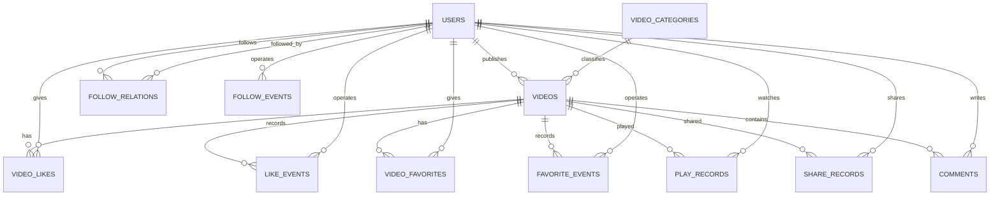

# 数据库设计说明

## 设计原则

基础业务表满足第三范式。视频的播放、点赞、收藏、转发和评论统计不重复存入 `videos`，而是由明细表及普通视图计算，避免缓存计数与明细不一致。

点赞、收藏和关注采用“当前关系表 + 历史事件表”：

- 当前关系表使用联合主键，保证每对主体最多存在一条有效关系。
- 取消操作删除当前关系，但在事件表追加取消事件。
- 再次操作会重新建立当前关系并追加新的历史事件。
- 服务层使用数据库事务保证当前关系与历史事件同时成功或同时回滚。

视频和评论采用逻辑删除，所有关联外键均使用 `RESTRICT`，不通过级联删除破坏历史。

完整字段定义见 [数据字典](data-dictionary.md)。

## 关系模式

下划线字段为主键，`FK` 表示外键，`UK` 表示唯一候选键。

- 用户：USERS（<u>id</u>, username UK, password_hash, nickname, bio, avatar_url, role, status, created_at, updated_at）
- 分类：VIDEO_CATEGORIES（<u>id</u>, name UK, sort_order）
- 视频：VIDEOS（<u>id</u>, author_id FK, category_id FK, title, description, file_path, status, published_at, updated_at, deleted_at）
- 当前关注：FOLLOW_RELATIONS（<u>follower_id FK, followed_id FK</u>, followed_at）
- 关注历史：FOLLOW_EVENTS（<u>id</u>, follower_id FK, followed_id FK, event_type, occurred_at, request_id UK）
- 当前点赞：VIDEO_LIKES（<u>user_id FK, video_id FK</u>, liked_at）
- 点赞历史：LIKE_EVENTS（<u>id</u>, user_id FK, video_id FK, event_type, occurred_at, request_id UK）
- 当前收藏：VIDEO_FAVORITES（<u>user_id FK, video_id FK</u>, favorited_at）
- 收藏历史：FAVORITE_EVENTS（<u>id</u>, user_id FK, video_id FK, event_type, occurred_at, request_id UK）
- 播放记录：PLAY_RECORDS（<u>id</u>, user_id FK, video_id FK, started_at, request_id UK）
- 转发记录：SHARE_RECORDS（<u>id</u>, user_id FK, video_id FK, shared_at, request_id UK）
- 评论：COMMENTS（<u>id</u>, user_id FK, video_id FK, content, created_at, is_deleted, deleted_at）

## E-R 关系

## 统计口径

| 指标 | 数据来源 | 口径 |
|---|---|---|
| 当前点赞数 | `video_likes` | 当前有效关系数量 |
| 当前收藏数 | `video_favorites` | 当前有效关系数量 |
| 播放量 | `play_records` | 成功播放请求累计数量 |
| 去重观看用户数 | `play_records` | 不同 `user_id` 数量 |
| 转发量 | `share_records` | 成功转发请求累计数量 |
| 有效评论量 | `comments` | `is_deleted = FALSE` 数量 |
| 粉丝/关注数 | `follow_relations` | 当前有效关系数量 |

`v_video_statistics` 先分别聚合各行为表，再与视频表连接，避免多张一对多表直接连接造成计数相乘。

## 并发与删除规则

新增视频互动前，服务层使用 `SELECT ... FOR UPDATE` 锁定视频行并检查其状态。视频删除也需要更新同一行，因此“删除视频”和“新增互动”并发时会串行化，提交后的结果不会出现已删除视频继续新增互动的情况。

