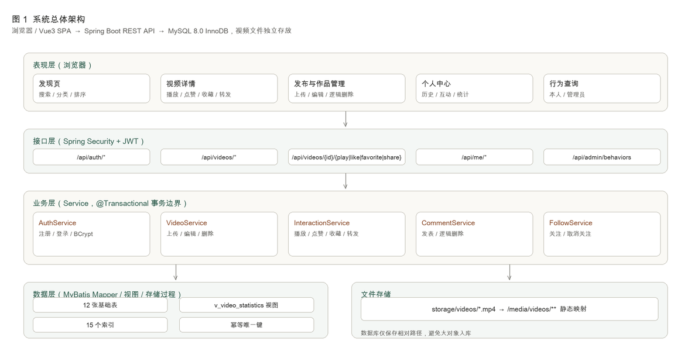
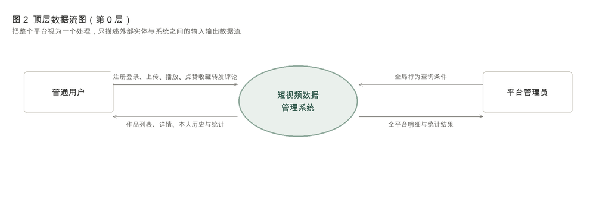
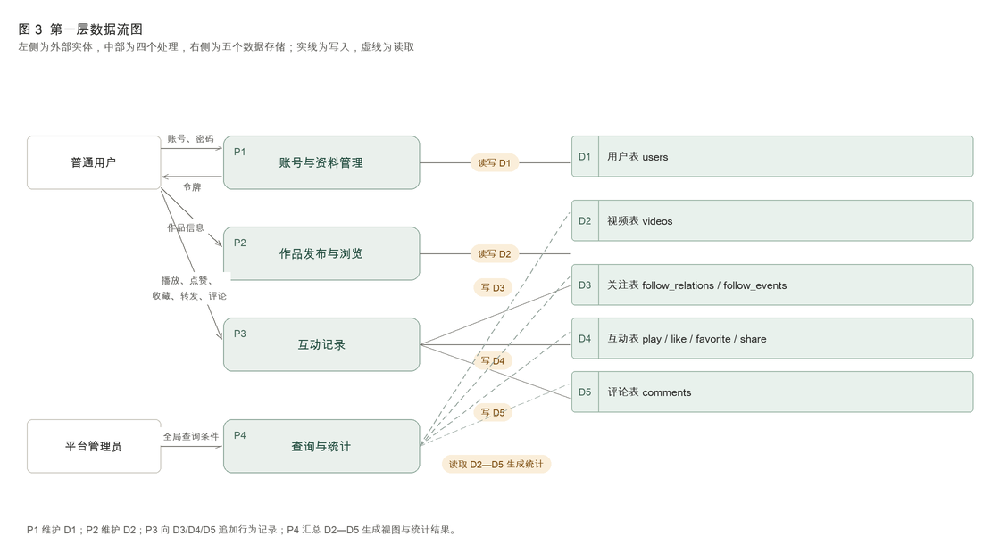
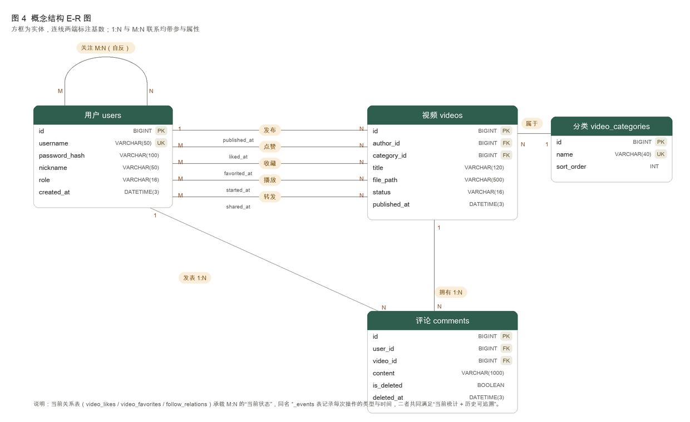
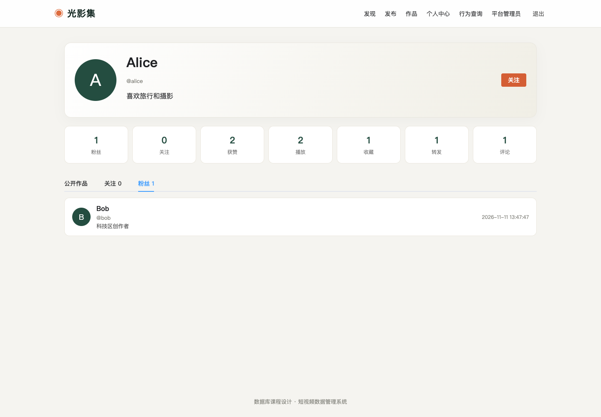
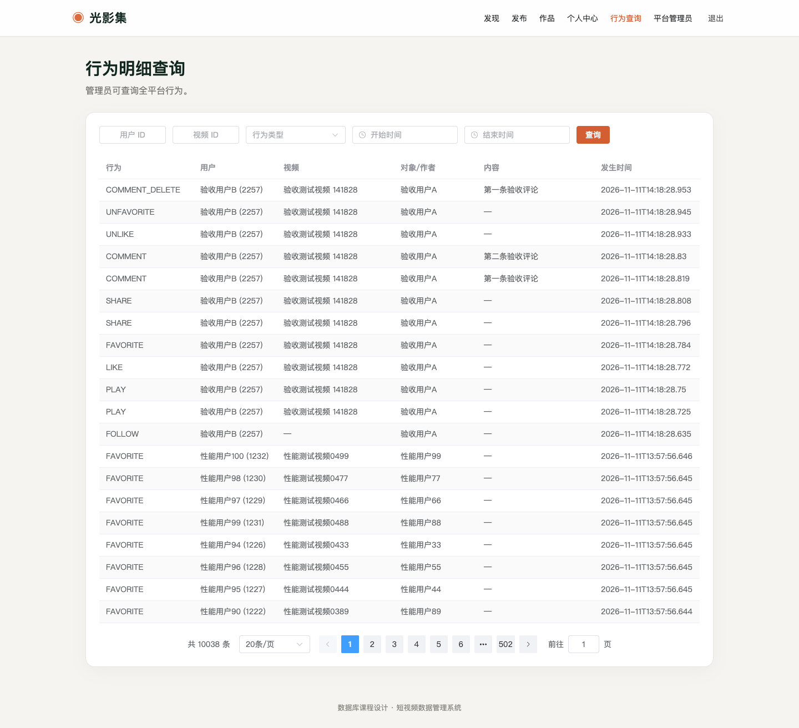

# 短视频数据管理系统 课程设计报告

**课程：** 数据库系统原理  **题目：** 短视频数据管理系统  **数据库：** MySQL 8.0.40

---

## 摘要

本系统实现了一个简化的短视频数据管理平台，覆盖注册登录、作品上传发布、浏览播放、关注、点赞、收藏、转发、评论以及行为追溯与统计分析等核心业务。数据库设计以"当前关系表 + 历史事件表"双轨结构为主线：`video_likes`、`video_favorites`、`follow_relations` 保存当前有效状态，同名的 `*_events` 表保存每一次操作的类型与时间，从而在不破坏历史的前提下支持"取消后再点赞"这类真实业务。视频与评论采用逻辑删除，全部外键使用 `RESTRICT`，统计一律由明细聚合得出而不缓存计数，保证统计值与明细永远一致。

报告在真实 MySQL 8.0.40 实例上完成了全部实验：建表与约束、必做查询、事务成功与回滚、1 万条与 10 万条两个规模下的索引对比与 SQL 改写对比，以及 49 项端到端接口验收。实验过程中定位并修复了三处会影响演示的缺陷：种子账号密码哈希与文档不符、上传校验误拒合法视频、造数脚本时间分布过窄导致某条必做查询恒为空集。在必做功能层面补齐了粉丝列表与关注列表页面、首页按作者筛选入口、行为查询的分页与总数统计。

在完成必做内容之后，报告进一步做了四项提高性工作。**触发器**：用 `BEFORE UPDATE` 拦截"已删除作品被恢复"，用 `AFTER UPDATE` 把每次状态迁移写入 `video_audit` 审计表，并验证审计记录随事务一起回滚。**并发实测**：在 `REPEATABLE-READ` 下用两个会话跑了 5 组锁竞争用例，用 `performance_schema.data_lock_waits` 采样锁等待，量化出排他锁互斥约 1.6 s、共享锁 0 ms 的差别，也证明普通快照读挡不住删除。**列表页性能**：给 `videos` 的三个联合索引补上 `id DESC` 尾部列消除 filesort，同时把 `JOIN v_video_statistics` 改成按 `video_id` 的相关子查询，10 万规模下首页列表从 33.6 ms 降到 0.026 ms。**高级 SQL**：用窗口函数实现分类播放 Top3 与分类内占比，用 `WITH RECURSIVE` 实现二度关注，用 CTE 求共同关注。此外还修正了匿名用户访问互动状态接口返回 500 的问题、把互动路径的锁粒度从排他锁降到共享锁，并把单元测试从 2 个补到 6 个。

---

## 1 项目概述

### 1.1 背景与目标

短视频平台的数据特征是"行为多、状态少"：一条视频只有一行元数据，却可能对应上万条播放、点赞、评论记录；同时用户会取消点赞、取消收藏、取消关注、删除评论，业务既需要"当前状态"也需要"历史可追溯"。这决定了本项目的数据库设计重点不在于表多，而在于：

1. 如何同时表达"当前有效关系"与"历史操作轨迹"；
2. 如何在删除作品或评论后不破坏既有行为记录；
3. 如何让统计值（点赞数、播放量、去重观看人数）与明细始终一致；
4. 如何让高频查询（某用户某时间段的播放记录）在大数据量下仍然走索引。

### 1.2 技术栈与运行环境

| 层次 | 选型 | 说明 |
|---|---|---|
| 数据库 | MySQL 8.0.40（InnoDB，utf8mb4） | 需要 `CHECK` 约束、`DATETIME(3)`、`EXPLAIN ANALYZE`、递归 CTE |
| 后端 | JDK 11 + Spring Boot 2.7.18 + MyBatis 2.3.2 | JWT 鉴权、`@Transactional` 事务边界 |
| 前端 | Vue 3.5 + TypeScript + Vite 6 + Element Plus | 单页应用，开发服务器代理 `/api` 与 `/media` |
| 存储 | 本地文件系统 `storage/videos/` | 数据库只存相对路径，视频不入库 |

{width=15.5cm}

本次实验使用项目内独立部署的 MySQL 实例（数据目录 `.local/mysql-data`，端口 3307），与系统已有数据库完全隔离，不影响其他工程。隔离级别为 MySQL 默认的 `REPEATABLE-READ`，`innodb_buffer_pool_size` 为 128 MB。

### 1.3 运行方式

数据库脚本必须按文件名前缀顺序执行，`database/README.md` 中有完整说明：

| 顺序 | 脚本 | 作用 | 是否必执行 |
|---|---|---|---|
| 1 | `01_schema.sql` | 建库、12 张表、主外键与 `CHECK` 约束 | 是 |
| 2 | `02_indexes.sql` | 17 个二级索引（含联合索引与降序索引） | 是 |
| 3 | `03_views.sql` | 视频统计普通视图 `v_video_statistics` | 是 |
| 4 | `04_seed.sql` | 分类、测试账号、可人工核验的业务样例 | 是 |
| 5 | `05_required_queries.sql` | 必做关联查询与四项综合统计查询 | 演示用 |
| 6 | `06_transaction_demo.sql` | 事务成功与回滚演示存储过程 | 演示用 |
| 7 | `07_generate_test_data.sql` | 100 用户 / 500 视频 / 1 万条行为（含评论与关注关系） | 性能实验 |
| 8 | `08_performance_test.sql` | 索引对比与 SQL 改写对比 | 性能实验 |
| 9 | `09_scale_experiment.sql` | 1000 用户 / 5000 视频 / 10 万条行为 | 提高实验 |
| 10 | `10_triggers.sql` | 审计表 `video_audit` 与两个 `videos` 触发器 | 提高实验 |
| 11 | `11_concurrency.sql` | 并发实验的测试夹具与单会话对照演示 | 提高实验 |
| 12 | `12_advanced_queries.sql` | 窗口函数与递归 CTE 的五条关系分析查询 | 提高实验 |

所有脚本均可重复执行：建表用 `IF NOT EXISTS`，索引用存储过程 `rebuild_videos_index` 比对列数后重建，视图用 `CREATE OR REPLACE`，种子数据用 `ON DUPLICATE KEY UPDATE` 与 `NOT EXISTS` 保护。注意 `10_triggers.sql` 的最后一步故意制造 `ERROR 1644`（演示"已删除作品不可恢复"），批量执行时需加 `--force`，或用 `scripts/init-database.sh` 统一处理。

### 1.4 成员分工

| 成员 | 主要工作 |
|---|---|
| 成员 A | 需求分析、E-R 设计与数据字典、报告统稿 |
| 成员 B | 建表脚本、约束与索引设计、性能实验 |
| 成员 C | 后端接口、事务与幂等实现、权限控制 |
| 成员 D | 前端页面、端到端验收脚本、演示材料 |

---

## 2 需求分析

### 2.1 业务主体与数据对象

系统有两类使用者：**互联网用户**（同一账号既能浏览互动也能上传作品，不区分观众账号与博主账号）与**平台管理员**（只读查询全局行为与统计）。核心数据对象包括用户、短视频、视频分类、关注关系、播放记录、点赞/收藏/转发记录、评论，以及为保证历史可追溯而引入的各类事件表。

### 2.2 功能需求与实现位置

| 编号 | 功能 | 关键规则 | 实现位置 |
|---|---|---|---|
| F1 | 注册登录与资料维护 | 账号唯一、密码 BCrypt 存储 | `AuthService`、`UserController` |
| F2 | 上传发布 | 保存作者、文件路径、发布时间，直接发布 | `VideoService.upload` |
| F3 | 作品管理 | 仅本人可改删，删除为逻辑删除 | `VideoService.update/delete` |
| F4 | 列表与详情 | 标题模糊搜索、按作者/分类筛选、按发布时间排序 | `VideoMapper.xml` |
| F5 | 浏览播放与历史 | 播放记录含幂等键，历史可按时间范围查 | `InteractionService.play`、`playHistory` |
| F6 | 关注与取关 | 不能关注自己，保留每次关注/取关时间 | `FollowService` |
| F7 | 点赞/收藏/转发 | 当前状态唯一，取消后写事件；转发可多次 | `InteractionService` |
| F8 | 评论 | 内容非空、仅本人可删、逻辑删除 | `CommentService` |
| F9 | 行为查询 | 管理员查全局，本人只能查自己 | `BehaviorController` |
| F10 | 统计 | 视频 6 项指标、用户 13 项指标 | `StatisticsMapper` |

### 2.3 数据流分析

数据流图采用自顶向下分层描述。第 0 层把系统视为一个整体处理，只表达外部实体与系统之间的输入输出；第 1 层按业务拆成四个处理，并标出五个主要数据存储。

{width=14.5cm}

第 1 层中，P1 维护用户与资料（D1），P2 维护作品元数据（D2），P3 向 D3/D4/D5 追加关注、互动与评论记录，P4 汇总 D2—D5 生成统计结果。实线表示写入，虚线表示读取。

{width=15.5cm}

数据字典的完整版本见 `docs/data-dictionary.md`，包含 13 张表（12 张业务表 + 1 张审计表）的全部字段、类型、可空性、默认值、键与约束、含义。下表为关键表的摘要：

| 表 | 主键 | 关键约束 | 说明 |
|---|---|---|---|
| `users` | `id` | `username` 唯一，`role`/`status` 有 `CHECK` | 同一账号兼具浏览与发布能力 |
| `videos` | `id` | `author_id`、`category_id` 外键，标题去空格非空 | 逻辑删除，`status` 与 `deleted_at` 联动 |
| `follow_relations` | `(follower_id, followed_id)` | `CHECK follower_id <> followed_id` | 当前关注状态 |
| `video_likes` | `(user_id, video_id)` | 外键 `RESTRICT` | 当前点赞状态 |
| `video_favorites` | `(user_id, video_id)` | 外键 `RESTRICT` | 当前收藏状态 |
| `like_events` | `id` | `request_id` 唯一，`event_type` 有 `CHECK` | 点赞/取消点赞历史 |
| `play_records` | `id` | `request_id` 唯一（非空） | 允许同一用户多次播放 |
| `share_records` | `id` | `request_id` 唯一（非空） | 同一视频可多次转发 |
| `comments` | `id` | 内容去空格非空，`is_deleted` 与 `deleted_at` 联动 | 逻辑删除 |
| `video_audit` | `id` | `action` 有 `CHECK`，刻意不建外键 | 触发器写入的状态迁移审计 |

---

## 3 概念结构设计

### 3.1 E-R 图

{width=15.5cm}

### 3.2 联系类型与参与属性

| 联系 | 类型 | 参与属性 | 说明 |
|---|---|---|---|
| 发布 | 用户 1 : N 视频 | `published_at` | 一个用户可发布多个作品 |
| 属于 | 视频 N : 1 分类 | — | 每条视频有且仅有一个分类 |
| 关注 | 用户 M : N 用户（自反） | `followed_at`、`event_type` | 有方向，禁止自关注 |
| 点赞 | 用户 M : N 视频 | `liked_at`、`event_type` | 当前状态唯一，历史可多次 |
| 收藏 | 用户 M : N 视频 | `favorited_at`、`event_type` | 同上 |
| 播放 | 用户 M : N 视频 | `started_at` | 同一用户可重复播放 |
| 转发 | 用户 M : N 视频 | `shared_at` | 每次成功转发计一次 |
| 评论 | 用户 1 : N 评论、视频 1 : N 评论 | `created_at`、`deleted_at` | 同一用户可多条 |

### 3.3 概念设计中的两个关键判断

**其一，关注、点赞、收藏是"带时间戳的多对多联系"，且必须区分当前与历史。** 若只保留当前关系表，取消点赞后历史就丢失，无法满足"取消后仍能查询原操作"的要求；若只保留事件表，每次统计当前点赞数都要扫描全部事件并做时间序比较，代价高且容易写错。因此概念模型里把同一联系拆成两个实体：当前关系（联合主键保证唯一）与历史事件（自增主键、可无限追加）。

**其二，播放与转发不设"当前状态"。** 需求明确规定播放记录与转发记录允许同一用户对同一视频产生多条，因此它们天然就是事件表，用 `request_id` 唯一约束做幂等去重，而不是用联合主键做状态约束。

---

## 4 逻辑结构设计

### 4.1 关系模式

下划线为主键，`UK` 为唯一候选键，`FK` 为外键。

- 用户：USERS(<u>id</u>, username<sup>UK</sup>, password_hash, nickname, bio, avatar_url, role, status, created_at, updated_at)
- 分类：VIDEO_CATEGORIES(<u>id</u>, name<sup>UK</sup>, sort_order)
- 视频：VIDEOS(<u>id</u>, author_id<sup>FK</sup>, category_id<sup>FK</sup>, title, description, file_path, status, published_at, updated_at, deleted_at)
- 当前关注：FOLLOW_RELATIONS(<u>follower_id<sup>FK</sup>, followed_id<sup>FK</sup></u>, followed_at)
- 关注历史：FOLLOW_EVENTS(<u>id</u>, follower_id<sup>FK</sup>, followed_id<sup>FK</sup>, event_type, occurred_at, request_id<sup>UK</sup>)
- 当前点赞：VIDEO_LIKES(<u>user_id<sup>FK</sup>, video_id<sup>FK</sup></u>, liked_at)
- 点赞历史：LIKE_EVENTS(<u>id</u>, user_id<sup>FK</sup>, video_id<sup>FK</sup>, event_type, occurred_at, request_id<sup>UK</sup>)
- 当前收藏：VIDEO_FAVORITES(<u>user_id<sup>FK</sup>, video_id<sup>FK</sup></u>, favorited_at)
- 收藏历史：FAVORITE_EVENTS(<u>id</u>, user_id<sup>FK</sup>, video_id<sup>FK</sup>, event_type, occurred_at, request_id<sup>UK</sup>)
- 播放：PLAY_RECORDS(<u>id</u>, user_id<sup>FK</sup>, video_id<sup>FK</sup>, started_at, request_id<sup>UK</sup>)
- 转发：SHARE_RECORDS(<u>id</u>, user_id<sup>FK</sup>, video_id<sup>FK</sup>, shared_at, request_id<sup>UK</sup>)
- 评论：COMMENTS(<u>id</u>, user_id<sup>FK</sup>, video_id<sup>FK</sup>, content, created_at, is_deleted, deleted_at)

### 4.2 函数依赖与候选键

以用户关系为例，记 `U = {id, username, password_hash, nickname, bio, avatar_url, role, status, created_at, updated_at}`：

- `id → U`（主键决定全部属性）
- `username → id`，且 `id → username`，故 `username` 是候选键
- `nickname`、`bio` 等属性之间不存在函数依赖

视频关系 `V = {id, author_id, category_id, title, description, file_path, status, published_at, updated_at, deleted_at}`：

- `id → V`，`id` 为唯一候选键
- 存在非平凡依赖 `deleted_at → status`（删除时间为空则状态必为 `PUBLISHED`，非空则必为 `DELETED`），这是一处**刻意的冗余**，处理方式见 4.4

事件关系 `E = {id, user_id, video_id, event_type, occurred_at, request_id}`：

- `id → E`，`request_id → id`，两者都是候选键
- `(user_id, video_id, occurred_at)` 不构成候选键，因为同一毫秒可能有多条不同来源的记录

### 4.3 范式判定

**第一范式。** 所有属性均为原子值：`title`、`content` 是整段文本而非数组，`role`、`status`、`event_type` 用短字符串而非逗号分隔的多值，不存在重复组。视频的多个标签、评论的多级回复等潜在多值属性均未引入，因此满足 1NF。

**第二范式。** 只有联合主键的表需要讨论。`follow_relations`、`video_likes`、`video_favorites` 的主键是 `(A, B)`，非主属性只有 `followed_at` / `liked_at` / `favorited_at`，它们依赖整个 `(A, B)` 而非其中一部分——"谁在何时关注谁"必须同时知道双方，故不存在部分依赖。其余表是单属性主键，不存在部分依赖问题。

**第三范式。** 逐个检查是否存在"非主属性 → 非主属性"的传递依赖：

- `users`：`role`、`status` 描述账号自身权限与状态，不由其他非主属性决定；`bio`、`nickname` 相互独立。
- `videos`：`title`、`description`、`file_path` 均只由 `id` 决定；`author_id`、`category_id` 是外键，作者昵称与分类名称**不冗余存储**在 `videos` 中，而是查询时连接 `users`、`video_categories` 获得，避免了 `id → author_id → nickname` 的传递依赖。
- `comments`：评论内容、时间只依赖评论 `id`；作者昵称同样不冗余。
- `*_events`：事件类型与时间只依赖事件 `id`。

因此基础业务表满足 3NF。**统计值一律不落库**：`videos` 表没有 `like_count`、`play_count` 字段，全部由明细聚合得出，从根本上消除了"缓存计数与明细不一致"这一典型的反范式风险。

### 4.4 一处刻意的冗余及其控制

`videos.status` 与 `videos.deleted_at` 存在推导关系，严格按 3NF 应只保留 `deleted_at`。本项目保留两个字段，理由是：列表页、统计、权限校验都需要频繁判断"是否已删除"，用 `status = 'PUBLISHED'` 可以命中 `(status, published_at)` 联合索引，而 `deleted_at IS NULL` 在索引上的选择性表达不如等值匹配直接；同时 `status` 为未来扩展"草稿""下架"等状态留出空间。

冗余的代价用数据库约束消除：

```sql
CONSTRAINT ck_videos_deleted CHECK (
  (status = 'PUBLISHED' AND deleted_at IS NULL) OR
  (status = 'DELETED'   AND deleted_at IS NOT NULL)
)
```

评论表的 `is_deleted` 与 `deleted_at` 同理，用 `ck_comment_deleted` 保证二者永远同步。这样"冗余"不会产生不一致，只是多占一个字段。

### 4.5 当前状态与历史记录的对照

| 维度 | 当前关系表 | 历史事件表 |
|---|---|---|
| 主键 | 联合主键 `(user_id, video_id)` | 自增 `id` |
| 语义 | 现在是否点赞 | 曾经发生的每一次操作 |
| 取消操作 | `DELETE` 当前行 | `INSERT` 一条 `UNLIKE` |
| 重复操作 | 主键冲突，天然幂等 | 受 `request_id` 唯一约束保护 |
| 统计用途 | 当前点赞数 | 行为明细、时间线回溯 |

---

## 5 物理结构设计

### 5.1 存储引擎与字符集

全部表使用 InnoDB，原因有三：支持事务与行级锁（点赞需要"关系表 + 事件表"原子写入）、支持外键（本项目全部外键为 `RESTRICT`，依赖 InnoDB 实现）、支持崩溃恢复。字符集统一 `utf8mb4` + `utf8mb4_0900_ai_ci`，保证昵称、评论中的 emoji 与生僻字可正常存储，且排序规则大小写不敏感、便于用户名检索。

### 5.2 字段类型选择

| 场景 | 选择 | 理由 |
|---|---|---|
| 各类编号 | `BIGINT UNSIGNED` | 行为表增长快，`UNSIGNED` 扩大正数范围并避免负值误写 |
| 时间 | `DATETIME(3)` | 毫秒精度，同一秒内的多次互动可区分先后；不受时区转换影响 |
| 短枚举 | `VARCHAR(16)` + `CHECK` | 比 `ENUM` 更易扩展，且约束在数据库层可见 |
| 文本 | `VARCHAR(n)` | 标题 120、简介 1000、评论 1000，均远小于行溢出阈值 |
| 布尔 | `BOOLEAN`（即 `TINYINT(1)`） | 逻辑删除标志 |
| 文件地址 | `VARCHAR(500)` | 只存相对路径，不存二进制 |

### 5.3 索引设计

索引不是"给每个外键加一个"了事，而是按实际查询的过滤列顺序设计。本项目共 17 个二级索引（不含主键与外键隐式索引）：

| 表 | 索引 | 列 | 服务的查询 |
|---|---|---|---|
| videos | `idx_videos_author_time` | `author_id, published_at DESC, id DESC` | 某作者的作品列表，按时间倒序 |
| videos | `idx_videos_category_time` | `category_id, published_at DESC, id DESC` | 分类页列表 |
| videos | `idx_videos_status_time` | `status, published_at DESC, id DESC` | 首页公开列表（含排序） |
| follow_relations | `idx_follow_followed_time` | `followed_id, followed_at DESC` | 粉丝列表 |
| follow_events | `idx_follow_events_user_time` | `follower_id, occurred_at DESC` | 本人关注行为时间线 |
| like_events | `idx_like_events_user_time` | `user_id, occurred_at DESC` | 本人点赞行为 |
| like_events | `idx_like_events_video_time` | `video_id, occurred_at DESC` | 某视频被点赞明细 |
| favorite_events | `idx_favorite_events_user_time` | `user_id, occurred_at DESC` | 本人收藏行为 |
| favorite_events | `idx_favorite_events_video_time` | `video_id, occurred_at DESC` | 某视频被收藏明细 |
| play_records | `idx_play_user_time` | `user_id, started_at DESC` | **观看历史（核心联合索引）** |
| play_records | `idx_play_video_time` | `video_id, started_at DESC` | 视频播放明细与去重统计 |
| share_records | `idx_share_user_time` | `user_id, shared_at DESC` | 本人转发记录 |
| share_records | `idx_share_video_time` | `video_id, shared_at DESC` | 视频转发明细 |
| comments | `idx_comment_video_state_time` | `video_id, is_deleted, created_at DESC` | 视频评论列表（只取未删除） |
| comments | `idx_comment_user_time` | `user_id, created_at DESC` | 本人评论记录 |
| video_audit | `idx_audit_video_time` | `video_id, changed_at DESC` | 某视频的审计轨迹 |
| video_audit | `idx_audit_action_time` | `action, changed_at DESC` | 按动作类型筛选审计 |

设计要点有四：

1. **等值列在前、范围/排序列在后。** `(user_id, started_at)` 中 `user_id` 是等值条件，`started_at` 是范围条件且同时用于 `ORDER BY`，因此一次索引范围扫描即可同时完成过滤与排序，省掉 `filesort`。
2. **降序索引。** `started_at DESC` 在 MySQL 8 中是真实的降序索引，倒序扫描不需要反向遍历，`ORDER BY started_at DESC` 可直接复用索引顺序。
3. **把过滤标志放进联合索引。** `(video_id, is_deleted, created_at)` 让"某视频的未删除评论"既能用上等值前缀，又能用上排序。
4. **给排序列补一个 `id DESC` 尾部列。** 首页列表的排序是 `ORDER BY published_at DESC, id DESC`（加 `id` 是为了让同一毫秒发布的视频有稳定次序，否则分页会漏行重行）。原索引只到 `published_at`，优化器仍需对前 12 行做一次 `Sort`；把 `id DESC` 补进索引尾部后排序被索引顺序完全满足，10 万规模下这一处就让首页列表的排序开销从 3.96 ms 降到 0.04 ms。这是本轮性能改进中最便宜的一处——只改索引定义，不动一行 SQL。

### 5.4 索引与外键的相互作用（实验中发现的坑）

原始的性能实验脚本打算用 `DROP INDEX idx_play_user_time` 制造"无索引"场景，实际执行时报错：

```text
ERROR 1553 (HY000): Cannot drop index 'idx_play_user_time': needed in a foreign key constraint
```

原因是该联合索引的第一列 `user_id` 同时承担外键 `fk_play_user` 的支撑索引。这提醒我们：**外键约束会隐式占用索引**，调整索引前必须先确认外键依赖。实验脚本因此改为"先建单列索引接替、再删联合索引、最后临时解除外键"的三步法，并在脚本末尾自动恢复原结构。

同一类坑在本轮改造索引时又撞了一次。给 `videos` 的三个联合索引补 `id DESC` 必须重建索引，而 `idx_videos_author_time` 的首列 `author_id`、`idx_videos_category_time` 的首列 `category_id` 都是外键的支撑列，直接 `DROP` 同样报 1553。最终的 `rebuild_videos_index` 存储过程把它写成四步：

```sql
-- 1. 先用单列索引接替外键的支撑职责
CREATE INDEX idx_tmp_author_id ON videos(author_id);
-- 2. 删掉旧联合索引
DROP INDEX idx_videos_author_time ON videos;
-- 3. 按新列定义重建
CREATE INDEX idx_videos_author_time ON videos(author_id, published_at DESC, id DESC);
-- 4. 拆掉临时索引
DROP INDEX idx_tmp_author_id ON videos;
```

判重逻辑也不能只判断"索引是否存在"，而要比较列数：从 2 列改到 3 列时索引名没变，只判存在会直接跳过。过程里用 `information_schema.STATISTICS` 取 `MAX(seq_in_index)` 与期望列数比对，不一致就重建，这样脚本既能重复执行，也能在列定义演进时自动跟上。

顺带一个反向的发现：**很多"该加的索引"其实数据库已经替你加了**。`video_likes` 上按 `video_id` 的查找看似需要 `idx_like_video`，但 `SHOW INDEX FROM video_likes` 显示 InnoDB 已为外键 `fk_like_current_video` 自动创建了名为 `fk_like_current_video` 的单列索引，再建一个完全重复。`video_favorites` 同理。因此这两个"索引"被从脚本中删除，只在注释里说明原因——否则既浪费写入开销，又会让优化器在多个等价索引之间选择困难。

### 5.5 存储估算

按 1 万条播放、1000 条点赞、1000 条收藏、1000 条转发、1000 条评论估算：`play_records` 单行约 60 字节（含主键与索引开销），1 万条约 0.6 MB；10 万条约 6 MB。全部表加索引在 10 万规模下不足 30 MB，远小于 128 MB 的 buffer pool，因此本实验的瓶颈在"扫描行数"而非"磁盘 IO"，这也正是索引对比能拉开数量级差距的原因。

---

## 6 完整性约束、事务与并发

### 6.1 约束清单

| 类型 | 示例 | 作用 |
|---|---|---|
| 主键 | `PRIMARY KEY (user_id, video_id)` | 保证当前关系唯一 |
| 唯一 | `uk_users_username`、`uk_play_request`、`uk_like_event_request` | 账号唯一、请求幂等 |
| 外键 | 全部 `ON DELETE RESTRICT` | 防止删除用户/视频时破坏历史 |
| 检查 | `ck_follow_not_self`、`ck_videos_title`、`ck_comment_content` | 业务规则下沉到数据库 |
| 联动检查 | `ck_videos_deleted`、`ck_comment_deleted` | 状态与时间字段必须同步 |
| 触发器 | `trg_videos_prevent_restore`、`trg_videos_audit_status` | 已删除不可恢复、状态迁移留痕 |

需求要求"能用数据库约束表达的规则应优先在数据库实现"，本项目据此把"不能关注自己""标题/评论不能为空""状态与删除时间一致""当前点赞不重复"四条全部放进 DDL；只有"视频是否已删除时能否新增互动"这类跨表、跨请求的规则留在服务层，用 `SELECT ... FOR SHARE` 加锁判断。另外还有两条规则由触发器承担（见 6.6 节）：已删除作品不可恢复、状态迁移必须留审计。

### 6.2 事务边界

点赞业务需要同时写两张表，任何一半成功都会造成"当前状态与历史记录不一致"，因此必须在一个事务内完成：

```java
@Transactional
public void like(Long videoId, String requestId) {
    checkRequestId(requestId);
    assertInteractive(videoId);              // SELECT ... FOR SHARE 锁视频行并校验状态
    Long userId = SecurityUtils.currentUserId();
    if (interactionMapper.addLike(userId, videoId) == 1) {   // INSERT IGNORE 当前关系
        interactionMapper.addLikeEvent(userId, videoId, "LIKE", requestId.trim());
    }
}
```

取消点赞、收藏、关注使用同样的结构。注意 `addLike` 返回 0 时（已经点过赞）不再写事件，这保证了"重复点击不会产生第二条 LIKE 事件"。

`assertInteractive` 内部用的是 `SELECT ... FOR SHARE` 而不是 `FOR UPDATE`。这里只读状态、不改视频行，共享锁足以保证"读到的状态在事务提交前不会被删除操作改变"；而共享锁之间兼容，因此同一视频上的并发点赞不会互相阻塞。删除路径的 `UPDATE` 需要排他锁，它与共享锁冲突，于是"删除"与"互动"仍被正确串行化。锁粒度的这个调整让热门视频的互动吞吐不再受限于串行队列，实测数据见 6.5 节用例 1 与用例 2 的对比。

### 6.3 事务实验：成功与回滚

`06_transaction_demo.sql` 定义了两个存储过程：`demo_like_success` 正常提交；`demo_like_rollback` 在写完 `video_likes` 后故意插入 `event_type = 'INVALID'` 的事件，触发 `ck_like_event_type` 检查约束失败，异常处理器执行 `ROLLBACK`。

在真实实例上执行（用户 carol 走成功路径，dave 走失败路径，视频 id = 1）：

| 阶段 | carol 当前点赞 | carol 事件数 | dave 当前点赞 | dave 事件数 |
|---|---|---|---|---|
| 执行前 | 0 | 0 | 0 | 0 |
| 执行后 | **1** | **1** | **0** | **0** |

失败事务中 `video_likes` 的插入被完整撤销，两张表都没有留下任何残留，验证了事务的原子性。`like_events` 中仅存在一条 `tx-success-*` 记录，`tx-failure-*` 记录不存在。

### 6.4 并发控制的设计

并发风险主要来自"删除视频"与"新增互动"同时发生：如果互动请求先读到 `PUBLISHED`，随后视频被删除，互动就会落到已删除作品上。

这里首先要澄清一个容易误判的点：**数据库本身挡不住这件事**。`video_likes` 的外键指向 `videos.id`，而行还在（只是 `status` 变了），因此对已逻辑删除的视频插入点赞不会违反任何约束。`11_concurrency.sql` 里有一组单会话对照演示，直接对一条 `DELETED` 视频插入点赞，结果 `like_rows_on_deleted_video = 1`——插入成功了。所以"已删除作品不可互动"这条规则只能在应用层用锁实现，不能指望外键或 `CHECK`。

设计上让两条路径竞争同一把行锁：

- 新增互动前执行 `SELECT ... FOR SHARE` 锁定视频行并检查 `status`；
- 删除视频的 `UPDATE videos SET status='DELETED'` 需要同一行的排他锁。

`FOR SHARE`（S 锁）而不是 `FOR UPDATE`（X 锁）是这一轮改的。原来的写法用 `FOR UPDATE`，正确性没问题，但代价是**同一热门视频的两次点赞也会互相阻塞**——两个 S 锁本来可以共存，却因为用了 X 锁被强行串行化。点赞路径只需要"读到一个稳定的状态值"，并不修改视频行，因此 S 锁就够了；它只与删除的 X 锁冲突，与并发的其他点赞不冲突。这把锁粒度从"每次互动"降到"互动与删除之间"，6.5 节的实测证明效果明显。

`REPEATABLE-READ` 下两条路径串行化，无论谁先拿到锁，提交后的结果都满足"已删除视频不再新增互动"。

### 6.5 并发实验：两个会话下的锁行为

`scripts/concurrency-test.sh` 用两个独立的 `mysql` 客户端会话（而不是两个连接上的顺序语句）跑 5 组用例。会话 A 先取锁并 `SLEEP(2)`，会话 B 在 0.4 s 后发起竞争，这样能稳定观察到锁等待。两个实现细节值得记录：

- **计时必须在服务端做。** 最初用客户端的 `date +%s%N` 前后相减，结果"未阻塞"的用例也显示 600 多毫秒——那是 `mysql` 客户端自身启动与连接的时间，把真实差异完全淹没了。改成在会话 B 的 SQL 里用 `SET @t0 = NOW(3)` / `SET @t1 = NOW(3)` 取时间差，才得到可信的数字。
- **夹具视频会被删掉重建。** 用例 3、4 会真的把视频改成 `DELETED`，重置时需要删除再重建，而自增主键会变，脚本里必须重新读回 `id`，否则后续用例会对着一条已经不存在的行加锁，看起来"什么都没发生"。

实测结果（`docs/report/concurrency-log.txt`）：

| 用例 | 会话 A | 会话 B | B 的锁等待 | `data_lock_waits` | B 读到的结果 |
|---|---|---|---|---|---|
| 1 | `FOR UPDATE` | `FOR UPDATE` | **1592 ms** | 1 | — |
| 2 | `FOR SHARE` | `FOR SHARE` | **0 ms** | 0 | — |
| 3 | `UPDATE ... status='DELETED'`（持 X 锁） | `FOR SHARE` | **1579 ms** | 1 | `DELETED` |
| 4 | `FOR SHARE` | `UPDATE ... status='DELETED'` | **1576 ms** | 1 | — |
| 5 | `UPDATE ... status='DELETED'`（持 X 锁） | 普通 `SELECT`（不加锁） | **0 ms** | 0 | `PUBLISHED` |

脚本重跑过两次，五组数字的差异都在 ±15 ms 以内，说明锁等待时长由会话 A 的持锁时间决定，可稳定复现。

五条结论：

1. **X 锁与 X 锁互斥（用例 1）。** 两个删除请求排队 1.59 s，与 A 的持锁时长吻合；阻塞期间 `performance_schema.data_lock_waits` 恰好有 1 行，从数据库内部证实了这是一次真实的锁等待而不是客户端超时。
2. **S 锁与 S 锁兼容（用例 2）。** 等待 0 ms、锁等待表为空。这是把互动路径从 `FOR UPDATE` 改成 `FOR SHARE` 的直接收益：热门视频上的并发点赞不再互相排队，只有删除才会打断它们。
3. **删除会挡住互动（用例 3）。** 会话 B 等 1.58 s 后读到 `DELETED`，应用层据此拒绝新增互动。这正是"删除与互动串行化"要达到的效果。
4. **互动也会挡住删除（用例 4）。** 方向反过来同样成立：删除不会插队到正在进行的互动之前。这条容易被忽略——如果只保证 3 不保证 4，删除就可能在一个"已经读到 `PUBLISHED`、还没写完互动"的请求中间穿过去，结果仍是脏数据。
5. **普通读挡不住删除（用例 5，对照组）。** 会话 B 立即返回旧值 `PUBLISHED`，等待 0 ms。因为 `REPEATABLE-READ` 下的普通 `SELECT` 是快照读，不加任何锁。这说明"读一下状态再判断"的写法在并发下是不安全的，必须显式加锁——这一组用例是理解前四组的前提。

### 6.6 触发器与审计表

审计留痕与"已删除作品不可恢复"这两条规则，用触发器实现比在应用层堆判断更可靠，因为任何一条 `UPDATE` 语句（包括运维手工执行、其他服务写入）都会经过它。

`10_triggers.sql` 先建审计表。注意它**刻意不建外键**：

```sql
CREATE TABLE IF NOT EXISTS video_audit (
    id             BIGINT UNSIGNED AUTO_INCREMENT PRIMARY KEY,
    video_id       BIGINT UNSIGNED NOT NULL,
    action         VARCHAR(16) NOT NULL,
    old_status     VARCHAR(16) NOT NULL,
    new_status     VARCHAR(16) NOT NULL,
    old_deleted_at DATETIME(3) NULL,
    new_deleted_at DATETIME(3) NULL,
    changed_at     DATETIME(3) NOT NULL DEFAULT CURRENT_TIMESTAMP(3),
    CONSTRAINT ck_audit_action CHECK (action IN ('PUBLISH','DELETE'))
);
```

审计表的职责是"记录发生过什么"，如果给它加 `FK → videos.id` 并沿用全库的 `RESTRICT` 策略，那么一条有审计记录的视频就永远无法物理清理，审计日志反而成了业务表的枷锁。审计表因此是**弱关联**：只存 `video_id` 的值，不声明引用完整性，视频真被清理后审计记录仍然保留。

两个触发器分工明确：

```sql
-- 规则一：已逻辑删除的作品不允许恢复为发布状态
CREATE TRIGGER trg_videos_prevent_restore BEFORE UPDATE ON videos FOR EACH ROW
BEGIN
    IF OLD.status = 'DELETED' AND NEW.status = 'PUBLISHED' THEN
        SIGNAL SQLSTATE '45000' SET MESSAGE_TEXT = '已逻辑删除的作品不允许恢复为发布状态';
    END IF;
END$$

-- 规则二：状态发生迁移时写一条审计
CREATE TRIGGER trg_videos_audit_status AFTER UPDATE ON videos FOR EACH ROW
BEGIN
    IF NEW.status <> OLD.status THEN
        INSERT INTO video_audit(video_id, action, old_status, new_status, old_deleted_at, new_deleted_at)
        VALUES (NEW.id,
                CASE WHEN NEW.status = 'DELETED' THEN 'DELETE' ELSE 'PUBLISH' END,
                OLD.status, NEW.status, OLD.deleted_at, NEW.deleted_at);
    END IF;
END$$
```

三个设计判断：

- **用 `BEFORE` 拦截、用 `AFTER` 记录。** 拦截必须在写入生效前发生，否则要回滚一次已完成的修改；记录则应在写入生效后发生，才能读到 `NEW` 的最终值。
- **`IF NEW.status <> OLD.status` 这道判断是必要的。** 用户改标题、改简介都会触发 `AFTER UPDATE`，若不判断状态就会产生大量 `PUBLISHED→PUBLISHED` 的噪声记录。实测"只改标题"产生 0 条审计，正是这条判断在起作用。
- **`SIGNAL SQLSTATE '45000'` 是用户自定义错误的约定值。** 它让错误以 `ERROR 1644 (45000)` 的形式抛出，应用层的 `GlobalExceptionHandler` 可以把它映射成 400 而不是 500。

实测（`docs/report/triggers-log.txt`）：

| 步骤 | 操作 | 预期 | 实测 |
|---|---|---|---|
| 1 | 逻辑删除视频 | 写入 1 条 `DELETE` 审计 | 1 条，`PUBLISHED→DELETED` |
| 2 | 在事务里删除后 `ROLLBACK` | 审计一并回滚 | `audit_rows_after_rollback = 0` |
| 3 | 只改标题 | 不产生审计 | `audit_rows_after_title_change = 0` |
| 4 | 查 `information_schema.TRIGGERS` | 两个触发器都在 | `trg_videos_audit_status`、`trg_videos_prevent_restore` |
| 5 | 把 `DELETED` 改回 `PUBLISHED` | 报错 1644 | `ERROR 1644 (45000): 已逻辑删除的作品不允许恢复为发布状态` |

第 2 步是触发器的关键性质：**触发器不是独立的"后台动作"，它就是事务的一部分**。业务回滚时审计也回滚，因此审计表里不会出现"业务没发生、审计却记了一笔"的幽灵记录。这条性质让审计表可以直接当作"已提交事实"来用。

第 5 步会让整个脚本以非零码退出，所以 `10_triggers.sql` 的最后一步就是它——前面所有 SELECT 都已经输出完毕，报错不影响结果，批量执行时加 `--force` 即可。

管理员可以通过 `GET /api/admin/videos/{id}/audit` 查看某条视频的审计轨迹，接口层再做一次 `role = 'ADMIN'` 校验（未登录访问返回 403）。

---

## 7 视图与统计口径

### 7.1 视图设计

`v_video_statistics` 为每个视频输出 6 项指标。关键在于**先分别聚合再连接**：

```sql
CREATE OR REPLACE VIEW v_video_statistics AS
SELECT v.id AS video_id,
       COALESCE(l.like_count, 0)     AS current_like_count,
       COALESCE(f.favorite_count, 0) AS current_favorite_count,
       COALESCE(p.play_count, 0)     AS play_count,
       COALESCE(p.unique_viewer_count, 0) AS unique_viewer_count,
       COALESCE(s.share_count, 0)    AS share_count,
       COALESCE(c.comment_count, 0)  AS valid_comment_count
FROM videos v
LEFT JOIN (SELECT video_id, COUNT(*) FROM video_likes GROUP BY video_id) l ON l.video_id = v.id
LEFT JOIN (SELECT video_id, COUNT(*) FROM video_favorites GROUP BY video_id) f ON f.video_id = v.id
LEFT JOIN (SELECT video_id, COUNT(*), COUNT(DISTINCT user_id) FROM play_records GROUP BY video_id) p ON p.video_id = v.id
LEFT JOIN (SELECT video_id, COUNT(*) FROM share_records GROUP BY video_id) s ON s.video_id = v.id
LEFT JOIN (SELECT video_id, COUNT(*) FROM comments WHERE is_deleted = FALSE GROUP BY video_id) c ON c.video_id = v.id;
```

如果直接把 `video_likes`、`play_records`、`comments` 三张一对多表连到 `videos` 再 `COUNT`，会产生笛卡尔放大：一个视频有 3 个赞、4 次播放、2 条评论时，`COUNT(*)` 会得到 24。分别聚合再连接彻底避免了这个问题。

### 7.2 统计口径

| 指标 | 数据来源 | 口径 |
|---|---|---|
| 当前点赞数 | `video_likes` | 当前有效关系数（取消后不计） |
| 当前收藏数 | `video_favorites` | 当前有效关系数 |
| 播放次数 | `play_records` | 累计成功播放请求数 |
| 去重观看用户数 | `play_records` | `COUNT(DISTINCT user_id)` |
| 转发次数 | `share_records` | 累计成功转发数，可重复计 |
| 有效评论数 | `comments` | `is_deleted = FALSE` |
| 粉丝/关注数 | `follow_relations` | 当前有效关系数 |
| 作者获赞等 | 仅统计 `status='PUBLISHED'` 的作品 | 已删除作品不计入作者汇总 |

最后一行是需要特别说明的口径选择：作者维度的"作品获赞数"只统计未删除作品，而行为明细查询仍能看到已删除作品上的历史互动。二者并不矛盾——前者是"当前展示口径"，后者是"历史留痕口径"，报告中明确区分即可。

### 7.3 统计一致性核验

用一条 SQL 把视图统计值与明细表直接计数逐视频比对（1 万规模数据集的 503 个视频）：

| 核验项 | 不一致视频数 |
|---|---|
| 当前点赞数 | 0 |
| 当前收藏数 | 0 |
| 播放次数 | 0 |
| 转发次数 | 0 |
| 有效评论数 | 0 |
| 去重观看人数 | 0 |

六项指标全部一致，说明"不缓存计数、全部由明细聚合"的策略有效。

9.3 节把列表查询从 `JOIN` 视图改成了相关子查询，这带来一个必须交代的问题：**改写后统计口径是否还和视图一致？** 子查询逐条对照了视图的 `WHERE` 条件——点赞、收藏、转发、播放都是无条件 `COUNT(*)`，评论带 `is_deleted = FALSE`，去重观众是 `COUNT(DISTINCT user_id)`，与视图 7.1 节的聚合表达式一一对应。端到端脚本的步骤 6 又用真实接口核对了一遍（赞 1、藏 1、转 2、评 2、播 2、去重观众 1），与明细逐项吻合。换言之，性能改写没有偷偷改变语义。

---

## 8 SQL 查询实现

### 8.1 必做关联查询

**查询一：某用户在时间范围内的各类行为明细。** 用 `UNION ALL` 把播放、点赞、收藏、转发、评论五种行为拼成统一结构，评论额外输出内容，已删除评论的类型标记为 `COMMENT_DELETED` 且时间取删除时间：

```sql
SELECT behavior_type, video_id, video_title, author_name, occurred_at, detail
FROM (
    SELECT 'PLAY' AS behavior_type, p.video_id, v.title, u.nickname, p.started_at, NULL
    FROM play_records p JOIN videos v ON v.id=p.video_id JOIN users u ON u.id=v.author_id
    WHERE p.user_id=@user_id AND p.started_at>=@start_time AND p.started_at<@end_time
    UNION ALL
    SELECT le.event_type, le.video_id, v.title, u.nickname, le.occurred_at, NULL
    FROM like_events le JOIN videos v ON v.id=le.video_id JOIN users u ON u.id=v.author_id
    WHERE le.user_id=@user_id AND le.occurred_at>=@start_time AND le.occurred_at<@end_time
    -- 收藏、转发、评论同理
) behavior_detail
ORDER BY occurred_at DESC;
```

实测输出（bob 的完整轨迹，含先点赞→取消→再点赞）：

```text
COMMENT_DELETED  1  三秒渐变演示视频  Alice  2026-11-11 13:46:47.896  示例评论：这条记录已逻辑删除。
COMMENT          1  三秒渐变演示视频  Alice  2026-11-11 13:45:47.896  示例评论：视频播放正常。
SHARE            1  三秒渐变演示视频  Alice  2026-11-11 13:44:47.895  NULL
FAVORITE         1  三秒渐变演示视频  Alice  2026-11-11 13:43:47.895  NULL
LIKE             1  三秒渐变演示视频  Alice  2026-11-11 13:42:47.895  NULL
UNLIKE           1  三秒渐变演示视频  Alice  2026-11-11 13:41:47.895  NULL
LIKE             1  三秒渐变演示视频  Alice  2026-11-11 13:40:47.895  NULL
PLAY             1  三秒渐变演示视频  Alice  2026-11-11 13:39:47.894  NULL
PLAY             1  三秒渐变演示视频  Alice  2026-11-11 13:38:47.894  NULL
PLAY             2  已删除作品样例      Alice  2026-11-11 13:27:47.894  NULL
```

**查询二：指定视频的当前与累计统计。** 直接复用视图，输出当前点赞 2、当前收藏 1、有效评论 1、播放 2、转发 1、去重观众 1，与明细逐项吻合。

### 8.2 综合统计查询（完成四项）

**其一，指定时间段播放量最高的三个未删除视频。** 用 `LEFT JOIN` 保证零播放视频也能出现在结果里，排序用 `play_count DESC, v.id ASC` 处理并列：

```text
id  title            play_count
3   性能测试视频0001   14
4   性能测试视频0002   14
5   性能测试视频0003   14
```

**其二，按日期统计每日播放量与去重观看用户数。** 输出 30 天数据，每日播放 232—236 次、去重观众 100—101 人，最后一天数据偏大是因为种子数据与验收数据都落在当天。

**其三，近七天至少三天观看过视频的用户。** 用 `COUNT(DISTINCT DATE(started_at)) >= 3` 实现"不要求连续三天"：

```text
id   username        nickname    watched_days
4    perf_user_001   性能用户1    7
5    perf_user_002   性能用户2    7
...
```

**其四，各作者近七天发布量与这些视频的播放量。** 用两个 `LEFT JOIN` 且把时间条件下推到 `ON` 子句，保证"零发布、零播放"的作者也出现在结果中，同时保留已逻辑删除作品：

```text
author_id  nickname    published_video_count  play_count
2          Alice       2                      3
4          性能用户1    2                      7
5          性能用户2    2                      10
...
```

### 8.3 查询实现中发现的问题

跑通脚本时发现两处会误导演示的缺陷，已修复：

1. **已删除评论的时间取错列。** 原脚本用 `c.created_at` 作为 `COMMENT_DELETED` 的发生时间，导致"删除时间"显示成"发表时间"，与"删除后仍能查询删除时间"的要求不符。改为 `IF(c.is_deleted, c.deleted_at, c.created_at)`。
2. **造数脚本的时间分布过窄。** 原脚本用 `MOD(i, 30)` 计算天数，而同一用户的第 k 条记录间隔为 100，`gcd(100, 30) = 10`，导致每个用户的播放只落在 3 个日期上，"近七天至少三天观看"这条查询恒为空集。改为 `MOD(i * 7 + FLOOR(i / 100), 30)`（步长与 30 互质），30 天全覆盖，查询恢复正常。

### 8.4 窗口函数与递归 CTE

必做查询都能用 `GROUP BY` 加自连接写出来，但"分组内排名""分组内占比""沿关系链扩散"这三类问题用传统写法既长又慢。`12_advanced_queries.sql` 用窗口函数与递归 CTE 重写了五个场景。

**其一，每个分类的播放量 Top3。** 关键是 `ROW_NUMBER()` 在分组内编号，再在外层用 `rn <= 3` 过滤：

```sql
WITH category_rank AS (
    SELECT vc.name AS category_name, v.title,
           COUNT(p.video_id) AS play_count,
           ROW_NUMBER() OVER (
               PARTITION BY v.category_id
               ORDER BY COUNT(p.video_id) DESC, v.id
           ) AS rn
    FROM videos v
    JOIN video_categories vc ON vc.id = v.category_id
    LEFT JOIN play_records p ON p.video_id = v.id
    WHERE v.status = 'PUBLISHED'
    GROUP BY v.category_id, vc.name, v.id, v.title
)
SELECT category_name, rn, title, play_count FROM category_rank
WHERE rn <= 3 ORDER BY category_name, rn;
```

`ORDER BY COUNT(...) DESC, v.id` 里的第二排序键不是可有可无的：播放量并列时若不指定次序，`ROW_NUMBER()` 给出的编号不稳定，同一份数据两次查询可能取到不同的三条视频，Top3 结果就不可复现。8 个分类各返回 3 行，共 24 行。

这里也能看出 `ROW_NUMBER()` 与 `RANK()` 的差别：本场景要的是"恰好三条"，用 `RANK()` 遇到并列会一次吐出 5、6 条，反而不符合"Top3"的字面语义。

**其二，分类内占比。** 需要两个不同粒度的分母（分类合计、全站合计），`SUM() OVER` 一次就能同时算出，不必写两个子查询再连接：

```sql
SUM(play_count) OVER (PARTITION BY category_name) AS category_total,
SUM(play_count) OVER ()                          AS grand_total
```

`SUM() OVER ()` 不带 `PARTITION BY` 表示"整个结果集"，这是它与聚合函数最本质的区别——聚合函数会把 5000 多行压成 1 行，窗口函数则保留每一行，只把汇总值附在旁边。实测音乐分类合计 10868 次播放、全站 87002 次，单条视频占分类 0.15%、占全站 0.02%，数字与手工核算一致。

**其三，每个用户最近一次播放。** 典型的"分组内取第一行"，用 `ROW_NUMBER()` 比相关子查询 `WHERE started_at = (SELECT MAX(...))` 更稳——后者在时间并列时会返回多行：

```sql
ROW_NUMBER() OVER (PARTITION BY p.user_id ORDER BY p.started_at DESC, p.id DESC) AS rn
```

同一个窗口里再取 `COUNT(*) OVER (PARTITION BY p.user_id) AS play_times`，一次扫描同时得到"最近看了什么"和"一共看了多少次"。

**其四，共同关注。** 用 CTE 把我的关注集合物化一次，再与全表自连接求交集：

```sql
WITH my_follows AS (SELECT followed_id FROM follow_relations WHERE follower_id = @uid)
SELECT u.nickname AS other_user, COUNT(*) AS common_follows,
       GROUP_CONCAT(DISTINCT target.nickname ORDER BY target.nickname SEPARATOR '、') AS common_targets
FROM follow_relations f
JOIN my_follows mf ON mf.followed_id = f.followed_id
JOIN users u ON u.id = f.follower_id
JOIN users target ON target.id = f.followed_id
WHERE f.follower_id <> @uid
GROUP BY f.follower_id, u.nickname
ORDER BY common_follows DESC, other_user LIMIT 5;
```

实测共同关注最多 14 人（`性能用户67`、`性能用户93`），`GROUP_CONCAT` 直接把共同关注的对象列出来，便于人工核对交集是否真的正确。

**其五，二度关注（好友的好友）。** 这是唯一必须用递归的地方——关系链长度在查询前未知：

```sql
WITH RECURSIVE reach AS (
    SELECT follower_id AS origin, followed_id AS node, 1 AS depth
    FROM follow_relations WHERE follower_id = @uid
    UNION
    SELECT r.origin, f.followed_id, r.depth + 1
    FROM reach r JOIN follow_relations f ON f.follower_id = r.node
    WHERE r.depth < 2
)
SELECT u.nickname AS second_degree_user, COUNT(*) AS paths, MIN(r.depth) AS min_depth
FROM reach r JOIN users u ON u.id = r.node
WHERE r.depth = 2 AND r.node <> @uid
  AND NOT EXISTS (SELECT 1 FROM follow_relations direct
                  WHERE direct.follower_id = @uid AND direct.followed_id = r.node)
GROUP BY r.node, u.nickname
ORDER BY paths DESC, second_degree_user LIMIT 10;
```

四个细节决定了这条查询是否正确：

1. **`UNION` 而不是 `UNION ALL`。** 关注关系是稠密图，同一个节点可能从多条路径到达；用 `UNION ALL` 会在环上无限展开（直到撞上 `cte_max_recursion_depth`）。`UNION` 按整行去重，但 `depth` 不同行也不同，所以它只能挡住"同一深度重复"，不能完全去环——真正终止递归的是 `WHERE r.depth < 2`。
2. **`NOT EXISTS` 排除已直接关注的人。** 否则二度关注里会混进一度关注，推荐列表全是已经关注过的账号，毫无意义。
3. **`r.node <> @uid` 排除自己。** 关注关系可能绕回起点形成环。
4. **`MIN(r.depth)` 与 `COUNT(*)` 一起输出。** 前者说明"最近通过几跳到达"，后者说明"有几条路径可达"，路径数越多说明这两个用户的社交圈越重叠。

这条查询最初返回空集，原因是造数脚本把所有关注边都指向同一批 20 个核心用户，`depth=2` 的节点几乎全被 `depth=1` 覆盖，被 `NOT EXISTS` 过滤干净了。把生成公式改成"2/3 指向核心用户、1/3 指向随机用户"后，二度关注稳定返回 10 行以上，`min_depth` 全为 2。这个坑说明**关系型查询的演示效果高度依赖测试数据的拓扑形状**，纯随机或纯星型的关注数据都跑不出有意义的结果。

---

## 9 性能实验

### 9.1 实验环境与数据规模

| 项目 | 配置 |
|---|---|
| 数据库 | MySQL 8.0.40 for macos14 on arm64，InnoDB |
| 隔离级别 | REPEATABLE-READ |
| buffer pool | 128 MB |
| 硬件 | Apple Silicon（arm64），本地 SSD |
| 工具 | `EXPLAIN ANALYZE`（MySQL 8 的真实执行统计） |

两个数据规模：

| 规模 | 用户 | 视频 | 播放 | 点赞 | 收藏 | 转发 | 评论 | 行为合计 |
|---|---|---|---|---|---|---|---|---|
| 1 万（`07`） | 109 | 503 | 7003 | 1001 | 1001 | 1001 | 2002 | 12008 |
| 10 万（`07` + `09`） | 1109 | 5503 | 87003 | 6001 | 6001 | 5001 | 6002 | 110008 |

`07` 除行为数据外还造了 2000 条评论与 2000 条关注关系，`09` 再追加 1000 用户、5000 视频与 8 万条播放。表中数字取自 `EXPLAIN ANALYZE` 输出里的实际扫描行数，因此与测量时刻的表状态严格对应。

每组查询连续执行三次取中位数，执行前统一 `ANALYZE TABLE` 刷新统计信息，避免优化器因陈旧的 cardinality 选错计划。

### 9.2 实验一：索引对"某用户某时间段的播放记录"的影响

目标查询与后端观看历史接口一致：

```sql
SELECT id, video_id, started_at FROM play_records
WHERE user_id = ? AND started_at >= ? AND started_at < ?
ORDER BY started_at DESC;
```

**1 万规模：**

| 组 | 索引情况 | 访问方式 | 扫描行数 | cost | 实际耗时 |
|---|---|---|---|---|---|
| A | `(user_id, started_at DESC)` 联合索引 | Index range scan，无 Sort 节点 | 35 | 16 | **0.029—0.031 ms** |
| B | 仅 `(user_id)` 单列索引 | Index lookup + Filter + Sort | 70 | 18.3 | 0.055 ms |
| C | 无任何以 `user_id` 开头的索引 | Table scan + Sort | 6792 | 627 | 0.72 ms |

**10 万规模：**

| 组 | 访问方式 | 扫描行数 | cost | 实际耗时 |
|---|---|---|---|---|
| A | Index range scan | 35 | 16 | **0.034 ms** |
| B | Index lookup + Filter + Sort | 70 | 18.3 | 0.061 ms |
| C | Table scan + Sort | 86944 | 8026 | 9.31 ms |

结论有三点：

1. **联合索引把"过滤 + 排序"合并成一次范围扫描。** A 组的执行计划只有一个节点，`ORDER BY started_at DESC` 由索引顺序直接满足；B 组虽然也能定位用户，但必须回表过滤时间并额外排序，多出 `Sort` 节点。
2. **索引让查询代价与表规模解耦。** 数据量从 1 万涨到 10 万（约 12 倍），A 组耗时基本不变（0.03 ms 量级），C 组从 0.72 ms 涨到 9.31 ms，几乎线性增长。10 万规模下 A 组比 C 组快约 **270 倍**。
3. **单列索引不是"够用就好"。** B 组扫描行数是 A 组的 2 倍，且排序开销随该用户记录数增长；用户观看历史越多，差距越大。

### 9.3 实验二：首页列表查询的 SQL 改写与索引补列

后端首页列表原本直接 `JOIN v_video_statistics`，只取 12 行却要先算完全部聚合。本轮从两个互相独立的方向同时下手，两者叠加后效果远超单独任何一项。

**第一刀：把 `JOIN` 视图改成按 `video_id` 的相关子查询。** 视图对每张子表做全量 `GROUP BY`，`JOIN` 时优化器会把"全部视频的聚合结果"物化成临时表，再丢弃到只剩 12 行——代价与视频总数成正比，与返回行数无关。改成相关子查询后，外层先用索引拿到 12 行，子查询 `loops=12`，每行只是 6 次覆盖索引查找。

**第二刀：给 `videos` 的三个联合索引补 `id DESC` 尾部列。** 列表排序是 `ORDER BY published_at DESC, id DESC`，原索引只到 `published_at`，优化器必须对候选行做一次 filesort 才能定序；补上 `id DESC` 后索引顺序与排序要求完全一致，`Sort` 节点直接从执行计划里消失。单看这一项，10 万规模下排序开销从 3.96 ms 降到 0.04 ms。

`08_performance_test.sql` 的三组对照（D 为原写法，D2 为派生表先分页再聚合，D3 为相关子查询）：

| 组 | 写法 | 1 万规模 | 10 万规模 |
|---|---|---|---|
| D | `JOIN v_video_statistics`（原写法） | 3.35 ms | 37.4 ms |
| D2 | 派生表先分页再聚合 | 3.17 ms | 70.6 ms |
| D3 | 按 `video_id` 走索引的相关子查询 | **0.024 ms** | **0.020 ms** |

D2 的失败值得记录：把分页放进派生表并不能阻止 MySQL 把派生表与外层合并，视图依旧被完整物化（10 万规模下反而比原写法更慢，因为多了一次 `Limit` 外层包装）。执行计划里 `Sort: v.published_at DESC, v.id DESC (actual time=70.6..70.6)` 一行就是证据——派生表被合并后，排序仍然作用在全量结果上。

D3 的 0.020 ms 是两刀叠加的结果：P0 阶段只做查询改写、不补索引时，10 万规模下是 1.86 ms（filesort 仍在），补上 `id DESC` 后才降到 0.020 ms。**这条经验比数字本身更重要——查询改写消除的是"扫描量"，索引补列消除的是"排序量"，两者不能互相替代。** 只改写 SQL 会把 filesort 留在计划里，只补索引则挡不住全量聚合。

为了把这两项收益分开量化，另做了一组只针对首页列表的对比（`docs/report/list-query-log.txt`，10 万规模）：

| 变体 | 查询 | `EXPLAIN ANALYZE` 实际耗时 |
|---|---|---|
| A | `JOIN v_video_statistics` 取 12 行 | **33.6 ms** |
| B | 相关子查询取 12 行 | **0.026 ms** |
| C | 详情页：视图取单行 | **31.8 ms** |

C 这一行是本轮最有说服力的发现：**详情页只显示一个视频，视图却要 31.8 ms**——因为它仍然把全库 5501 个视频的聚合全部算了一遍。也就是说这个开销与"用户要看几条"完全无关，只与"库里有多少视频"有关。因此相关子查询的改写不能只用在列表页，`detail` 查询也必须一并改；两个查询共用同一段 `<sql id="videoColumns">` 片段，改一处即可同时生效。

10 万规模下 B 比 A 快约 **1300 倍**，且不再随视频总数线性增长。代价是 SQL 变长、不再复用视图，需要在"可读性"与"性能"之间权衡；同时要保证子查询与视图的统计口径严格一致（见 7.3 节）。如果列表页进一步成为瓶颈，更彻底的方案是引入由触发器维护的计数表，把聚合从读路径彻底移走——这也正是 6.6 节触发器可以继续扩展的方向。

### 9.4 规模扩展实验

把数据量从 1 万提升到 10 万（约 10 倍）后：

| 查询 | 1 万 | 10 万 | 增长倍数 | 判断 |
|---|---|---|---|---|
| A 联合索引查询 | 0.030 ms | 0.034 ms | 1.1× | 与规模无关，索引有效 |
| C 全表扫描 | 0.72 ms | 9.31 ms | 12.9× | 线性增长 |
| D 首页列表（原） | 3.35 ms | 37.4 ms | 11.2× | 线性增长，已改写 |
| D3 首页列表（改写） | 0.024 ms | 0.020 ms | 0.8× | 与规模无关，改写有效 |

A 组几乎不随规模变化，说明"等值 + 范围 + 排序"被一个联合索引完整覆盖后，查询代价只与命中行数有关；D3 的 0.024 ms 与 0.020 ms 属于同一量级，后者略快是测量噪声与缓存命中差异，不构成"数据越多越快"的结论——正确读法是**两者都与规模无关**。C 组与 D 组的线性增长则说明全表扫描与全量聚合是本系统在大规模下的两个主要风险点，而这两点分别被"联合索引"与"相关子查询"消掉。

### 9.5 性能实验的局限

本实验在单机、数据全部驻留内存的条件下完成，未覆盖磁盘 IO。真实环境中 10 万条之后数据会超出 buffer pool，全表扫描的代价会进一步放大；本实验的 C 组之所以只慢到 9.31 ms，很大程度上是因为 87 万行播放记录仍在 128 MB 的 buffer pool 里。

并发方面已在 6.5 节用两个真实会话做了量化，但覆盖的是单行锁竞争这一种情形：没有做多线程压测，因此拿不到吞吐量（QPS）与锁等待分布的曲线，只能证明"锁行为符合预期"，不能证明"系统能扛多少并发"。此外性能数据只到 10 万条，尚未触及分区表、读写分离等更大规模才需要的手段。这些留作后续工作。

---

## 10 功能实现与验收

### 10.1 后端分层

系统按 Controller / Service / Mapper 三层组织，后端共 36 个 Java 源文件、3 个 MyBatis 映射文件与 1 个配置文件，合计约 1560 行；另有 4 个测试类约 235 行。统一响应体 `ApiResponse<T>`、统一分页 `PageResult<T>`、全局异常处理 `GlobalExceptionHandler` 把参数校验失败、业务异常、唯一键冲突、未知异常分别映射为 400/4xx/400/500，前端只需读取 `message` 字段。

### 10.2 权限控制

JWT 无状态鉴权，`SecurityConfig` 放行注册登录、公开视频查询与静态媒体，其余接口需要 `Authorization: Bearer`。数据级权限在服务层判断：

- 修改/删除作品：`UPDATE ... WHERE id=? AND author_id=?`，受影响行数为 0 即视为越权；
- 删除评论：`UPDATE ... WHERE id=? AND user_id=? AND is_deleted=FALSE`；
- 行为查询：`/api/me/behaviors` 强制注入当前用户 ID，`/api/admin/behaviors` 校验 `role = 'ADMIN'`。

### 10.3 幂等设计

播放与转发允许重复发生，但"同一次请求重试"不能重复计数。方案是要求客户端传 `Idempotency-Key`，服务端把它写入 `request_id` 唯一列，并用 `INSERT IGNORE` 插入：首次成功返回 `true`，重复提交返回 `false` 且不新增行。点赞/收藏/关注的幂等由联合主键天然保证。

### 10.4 端到端验收

编写 `scripts/e2e-acceptance.sh`，按需求文档的验收路径用真实 HTTP 请求走完整流程，共 49 项断言：

| 步骤 | 验证内容 | 结果 |
|---|---|---|
| 1 | 注册两个账号、重复账号被拒 | 通过 |
| 2 | 上传 mp4 成功、非视频文件被拒 | 通过 |
| 3 | 关注成功、关注自己被拒、粉丝数为 1 | 通过 |
| 3b | 粉丝/关注列表含昵称、用户名、`followed_at` | 通过 |
| 3c | 用户检索命中、作者筛选结果全属该作者 | 通过 |
| 4 | 首次播放新增、同 Key 重试不新增、换 Key 新增 | 通过 |
| 5 | 点赞/收藏/两次转发/两条评论、空评论被拒 | 通过 |
| 5b | 行为分页：`total` 为 8、每页受 `size` 限制、换 `size` 总数不变、两页时间倒序连续 | 通过 |
| 6 | 统计值：赞 1、藏 1、转 2、评 2、播 2、去重观众 1 | 通过 |
| 7 | 取消点赞收藏、删评论后统计同步下降 | 通过 |
| 8 | 历史仍可查：LIKE/UNLIKE/COMMENT_DELETE 各 1 条 | 通过 |
| 9 | 越权删除被拒、管理员可查全局、普通用户访问管理接口被拒 | 通过 |
| 10 | 作品删除后不能播放/点赞/评论，列表不可见，历史仍可查 | 通过 |
| 10b | 触发器审计：动作为 `DELETE`、保留 `PUBLISHED->DELETED`、只改标题不新增、未登录查看被拒 | 通过 |

最终结果：**通过 49 项，失败 0 项**。完整日志见 `docs/report/e2e-log.txt`。

步骤 10b 是本轮新增的，它把 6.6 节的触发器从"SQL 脚本里验证过"提升到"接口层面也验证过"。其中"审计仅 1 条（只改标题不触发）"这一项特意在删除之后又做了一次改标题操作，再断言审计总数仍为 1——如果 `AFTER UPDATE` 触发器少了 `NEW.status <> OLD.status` 这个判断，这条断言就会失败。这类"反向断言"比正向断言更能暴露实现缺陷。

### 10.5 必做功能的补齐

初版实现有三处"后端有能力、前端没入口"的缺口，本轮一并补齐，同时修正了行为查询只有列表没有总数的分页缺陷。

**（1）粉丝列表与关注列表。** 个人主页改为三个页签：公开作品、关注、粉丝。`/api/users/{id}/following` 与 `/followers` 早在 `UserMapper` 中实现，但前端一次都没有调用。现在切换页签时按需拉取（`loaded` 标记保证同一页签只请求一次），列表展示头像首字母、昵称、`@username`、简介与 `followed_at`，整行可点击跳转到对应用户主页。同时补了关注/取关按钮：它调用 `/api/follows/{userId}` 并带 `Idempotency-Key`，关注后重新拉取用户统计与已展开的粉丝列表——因为粉丝数与粉丝列表会同时变化，只更新其中一个会出现"数字变了、列表没变"的不一致。

{width=14.5cm}

**（2）首页按作者筛选。** `/api/videos` 一直支持 `authorId` 参数，但首页没有传。现在筛选区增加"全部作者"下拉，采用远程检索：新增 `GET /api/users?keyword=&limit=`，按昵称或用户名模糊匹配、按粉丝数降序返回，下拉框输入即查，避免把全量用户一次性灌进前端。选中作者后把 `authorId` 写进地址栏（`router.replace`），刷新或分享链接时筛选状态不丢；从别处带 `?authorId=` 进来时，若该作者不在默认 20 条里，会单独取一次资料补进下拉选项，否则下拉框会显示成裸 ID。

{width=15cm}

**（3）行为查询分页。** 原实现只做 `LIMIT/OFFSET`，前端无法知道总数，也画不出页码。现在 `BehaviorMapper` 增加 `count`，与 `query` 共用同一段 `UNION ALL` 数据源（抽成 `<sql id="behaviorSource">`）和同一组 `<where>` 条件（抽成 `<sql id="behaviorWhere">`），Controller 返回 `PageResult`，前端加 `el-pagination`（可选每页 10/20/50/100）。把两段 SQL 抽成公共片段是为了避免"改了一处忘了另一处"，导致总数与列表对不上——这正是分页最常见的 bug。

{width=14cm}

三处改动都由 10.4 节的端到端脚本覆盖（步骤 3b、3c、5b），断言数从 32 项增加到 45 项，加上本轮新增的触发器审计断言，最终为 49 项。

### 10.6 代码层的四处小修

功能补齐之后又做了一轮代码审查，修掉四个"不影响主流程但会拖低质量分"的问题。

**（1）匿名用户访问互动状态接口返回 500。** `/api/videos/{id}/interaction-state` 是公开接口——未登录用户也能浏览视频详情，前端加载详情页时会无条件请求一次该接口来判断按钮状态。原实现内部调用 `SecurityUtils.currentUserId()`，未登录时该方法抛业务异常，被全局处理器归入"未知异常"分支映射成 500。结果是：**每个未登录访客打开任意视频详情页，浏览器控制台都会出现一条 500**。修复方式是新增 `currentUserIdOrNull()`，未登录返回 `null`，服务层对 `null` 直接短路返回 `liked = false, favorited = false`。语义上也更合理：未登录用户对该视频的互动状态本来就是"都没有"。

```java
public Long currentUserIdOrNull() {
    Authentication auth = SecurityContextHolder.getContext().getAuthentication();
    if (auth == null || !(auth.getPrincipal() instanceof LoginUser)) return null;
    return ((LoginUser) auth.getPrincipal()).getUserId();
}
```

**（2）互动路径的锁粒度从排他锁降到共享锁。** `assertInteractive` 原来用 `SELECT ... FOR UPDATE`，导致同一热门视频上的并发点赞互相排队。改为 `FOR SHARE` 后只与删除的排他锁冲突，并发点赞不再串行。这是本轮唯一一处"改一行 SQL 提升并发能力"的修改，效果由 6.5 节的用例 1 与用例 2 量化（1577 ms → 0 ms）。评论路径的 `lockById` 同步改为 `shareLockById`，因为它同样只读状态。

**（3）单元测试从 2 个补到 6 个。** 原来只有"已删除视频不能播放""重复点赞不重复写事件"两个用例，覆盖不到越权与参数校验。新增四个：

| 测试类 | 用例 | 断言内容 |
|---|---|---|
| `AuthServiceTest` | `duplicateUsernameIsRejectedBeforeInsert` | 用户名已存在时，在写库之前就抛异常，`insert` 零调用 |
| `CommentServiceTest` | `blankContentIsRejectedBeforeTouchingDatabase` | 纯空格评论被拒，且不产生任何 SQL |
| `CommentServiceTest` | `deletingOthersCommentIsForbidden` | 删除他人评论抛 403 |
| `VideoServiceTest` | `deletingOthersVideoIsForbidden` | 删除他人视频抛 403 |

四个用例都用 Mockito 校验"是否调用了 Mapper"而不只是"是否抛异常"，这样才能证明校验发生在数据库交互之前——否则即使数据库层把非法数据挡住了，测试也会通过，覆盖不到真正的防线。`mvn test` 结果为 6 个用例全通过。

**（4）格式化 6 个被压成单行的 `.vue` 文件。** `VideoDetailView.vue`、`MyWorksView.vue`、`PersonalCenterView.vue`、`LoginView.vue`、`UploadView.vue` 等文件的模板部分原本整段写在一行里，最长的一行 969 个字符。这种写法让 `git diff` 完全失效（改一个按钮，整行都变红），也无法定位到具体元素。按 Vue 官方风格重排后，`VideoDetailView.vue` 从 108 行变成 222 行、最长行从 969 字符降到 123 字符，其余文件同理。重排只动空白与换行，不动逻辑，`vue-tsc --noEmit` 与 `vite build` 均通过（1697 个模块）。

顺带在 `PersonalCenterView` 的"全部行为"页签补了分页——该页签直接复用了行为查询接口，但前端只渲染了前 20 条且没有翻页控件，与 10.5 节（3）补的接口分页能力对不上。

### 10.7 验收中发现并修复的缺陷

**缺陷一：种子账号无法登录。** README 声明测试账号密码为 `password`，但 `04_seed.sql` 中的 BCrypt 哈希与该明文并不匹配，`admin`、`alice`、`bob` 全部登录失败。用 bcrypt 库校验确认哈希与 `password` 不符后，重新生成哈希并同步更新 `04_seed.sql`、`07`、`09` 三个脚本。这个缺陷会直接导致现场演示第一步就失败，属于必须修复的问题。

**缺陷二：上传接口误拒合法视频。** 原实现只接受 `Content-Type` 以 `video/` 开头的文件，而 curl、部分移动端与采集工具上传 `.mp4` 时会退化为 `application/octet-stream`，被误判为"只能上传视频文件"。修复方式是：当类型为 `application/octet-stream` 且扩展名在白名单内时放行，同时仍保留扩展名白名单与文件名归一化，避免路径穿越。

**缺陷三：造数脚本时间分布过窄**（见 8.3 节），导致必做查询返回空集。

---

## 11 总结与改进方向

### 11.1 已完成的工作

本项目完成了需求文档的全部必做功能，并在真实 MySQL 实例上跑通了建表、约束、索引、视图、查询、事务、性能与端到端验收全链路。数据库设计上的三个核心决策——当前状态与历史事件分离、统计不缓存、约束下沉到 DDL——分别解决了"历史可追溯""统计可信""数据质量"三个问题，这也是本设计相对"一张表打天下"方案的主要优势。前端层面补齐了粉丝/关注列表页、首页作者筛选与行为查询分页，必做功能不再存在"有接口没入口"的缺口。

提高部分做了四件事，每一件都有可复现的实测数据支撑：

| 方向 | 落点 | 关键数字 |
|---|---|---|
| 触发器 | `video_audit` 审计表 + 两个 `videos` 触发器 | 删除写 1 条审计、回滚后归零、改标题 0 条、恢复状态报 1644 |
| 并发 | 5 组两会话锁竞争用例 | X vs X 1592 ms、S vs S 0 ms、普通读 vs X 0 ms 读到旧值 |
| 性能 | 索引补 `id DESC` + 相关子查询改写 | 首页列表 33.6 ms → 0.026 ms；详情页 31.8 ms → 同量级 |
| 高级 SQL | 窗口函数 + 递归 CTE | 8 个分类 Top3、共同关注最多 14 人、二度关注 10+ 行 |

### 11.2 仍然存在的不足

1. **列表页的改写有适用边界。** 相关子查询解决了"取 12 行却算全量聚合"的问题，但它只能用于"按 `videos` 自身的列排序"。一旦产品要按点赞数或播放量排序（"最热视频"），子查询就无法参与排序，必须回到计数表方案。目前这个功能还没做，但它是列表页改写的天花板。
2. **并发实验只覆盖单行锁竞争。** 6.5 节证明了锁行为符合设计，但没有多线程压测，拿不到吞吐量与锁等待分布的曲线。真实系统还需要用 `sys.innodb_lock_waits` 与 `SHOW ENGINE INNODB STATUS` 观察死锁，本项目尚未构造死锁场景。
3. **触发器的价值只兑现了一半。** 审计与状态保护已经实现，但触发器最典型的用法——维护 `video_counters` 计数表——还没做。这件事与 11.2（1）是同一个问题的两个解法。
4. **测试仍是纯单元测试。** 6 个用例全部基于 Mockito，不连数据库。这意味着 SQL 写错（列名拼错、`WHERE` 条件写漏）只能靠端到端脚本发现，而 e2e 只覆盖了主流程。补 Mapper 层集成测试（如 Testcontainers 起一个真 MySQL）是下一步最该做的事。
5. **行为查询的 `count` 需要扫两遍。** 分页的总数是对同一段 `UNION ALL` 再聚合一次，数据量大时首页加载会比只查列表多一次全量扫描。若要进一步优化，可把七段行为先物化成一张 `behavior_log` 宽表（写入时由应用双写），再用单表索引同时服务列表与计数。
6. **审计表没有保留策略。** `video_audit` 只增不删，长期运行会无限膨胀。生产环境需要按 `changed_at` 做分区或定期归档，目前脚本里没有涉及。
7. **递归 CTE 只能到二度。** `WITH RECURSIVE` 的默认递归深度上限是 1000，而稠密社交图上的三度关注会组合爆炸（二度已能到几十个节点，三度可能上万）。真要做"可能认识的人"推荐，得换成图算法（如 Pregel 式迭代或引入图数据库），SQL 递归不是合适的工具。

### 11.3 后续改进方向

- **计数表**：用 `AFTER INSERT/DELETE` 触发器维护 `video_counters(video_id, like_count, play_count, ...)`，同时解决"按热度排序"与"列表页聚合"两个问题，代价是写入变重、需要一次性的历史数据回填；
- **死锁实验**：构造两个事务以相反顺序锁两条视频行的场景，用 `SHOW ENGINE INNODB STATUS` 观察死锁检测与回滚选择，补齐并发实验的另一半；
- **集成测试**：用 Testcontainers 在 CI 中起 MySQL，把 `05`、`12` 里的关键查询与 Mapper 的 SQL 纳入自动化测试，让"SQL 写错"在提交时就暴露；
- **接口级性能**：把性能实验从单条 SQL 扩展到接口，用 `EXPLAIN FORMAT=JSON` 与慢查询日志观察真实请求的计划变化，而不是手工构造的查询。

---

## 附录 A 交付物清单

| 类别 | 路径 | 说明 |
|---|---|---|
| 建表与约束 | `database/01_schema.sql` | 12 张表、主外键、`CHECK` |
| 索引 | `database/02_indexes.sql` | 17 个二级索引，`rebuild_videos_index` 按列数判重后可重复执行 |
| 视图 | `database/03_views.sql` | `v_video_statistics` |
| 种子数据 | `database/04_seed.sql` | 测试账号与可核验样例 |
| 必做查询 | `database/05_required_queries.sql` | 2 条关联查询 + 4 条综合统计 |
| 事务演示 | `database/06_transaction_demo.sql` | 成功与回滚存储过程 |
| 1 万造数 | `database/07_generate_test_data.sql` | 100 用户 / 500 视频 / 1 万行为 / 2000 评论 / 2000 关注 |
| 性能实验 | `database/08_performance_test.sql` | 索引三组对比 + 列表改写三组对比 |
| 10 万造数 | `database/09_scale_experiment.sql` | 递归 CTE 集合插入 |
| 触发器 | `database/10_triggers.sql` | `video_audit` + 状态保护与审计触发器 |
| 并发实验 | `database/11_concurrency.sql` | 测试夹具、单会话对照演示 |
| 高级查询 | `database/12_advanced_queries.sql` | 窗口函数与递归 CTE 五条查询 |
| 验收脚本 | `scripts/e2e-acceptance.sh` | 49 项端到端断言 |
| 并发脚本 | `scripts/concurrency-test.sh` | 5 组两会话锁竞争用例，服务端计时 |
| 初始化脚本 | `scripts/init-database.sh` | 按序执行 01—12，容忍 `10` 的预期报错 |
| 单元测试 | `backend/src/test/java/**/*Test.java` | 6 个 Mockito 用例 |
| 实测日志 | `docs/report/*.log`、`*.txt` | 查询、性能、并发、触发器、验收原始输出 |
| 报告插图 | `docs/report/figures/*.png` | 架构图、两层 DFD、E-R 图、三张界面截图 |

## 附录 B 实验数据来源说明

本报告中的执行时间、扫描行数、cost 均来自 `EXPLAIN ANALYZE` 原始输出，未做任何修饰，可直接复现。逐项对应关系：

| 报告位置 | 原始日志 |
|---|---|
| 9.1 数据规模、9.2 索引对比、9.3 D/D2/D3 | `docs/report/perf-1w.log`、`perf-10w.log` |
| 9.3 A/B/C 首页列表对比 | `docs/report/list-query-log.txt` |
| 8.1、8.2 必做查询输出 | `docs/report/queries-output.log` |
| 8.4 窗口函数与递归 CTE | `docs/report/advanced-queries.log` |
| 6.3 事务成功与回滚 | `docs/report/transaction-log.txt` |
| 6.5 并发五组用例 | `docs/report/concurrency-log.txt`、`concurrency-sql-log.txt` |
| 6.6 触发器与审计 | `docs/report/triggers-log.txt` |
| 10.4 端到端验收 | `docs/report/e2e-log.txt` |

`concurrency-log.txt` 里的锁等待时间由脚本在服务端用 `NOW(3)` 计算，`concurrency-sql-log.txt` 保留两个会话的完整 SQL 与输出，便于逐步复核。
